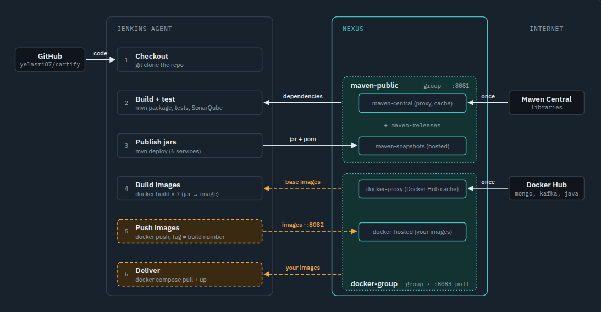
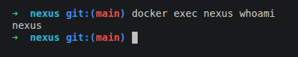
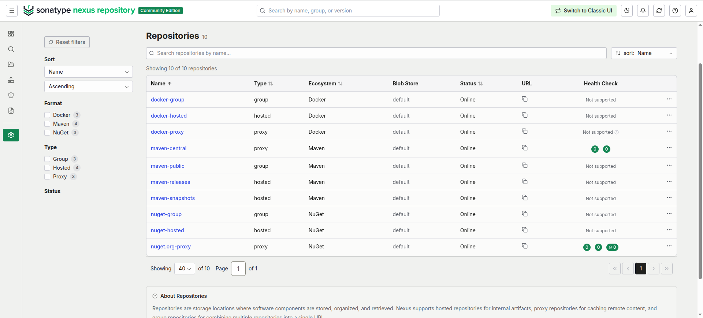
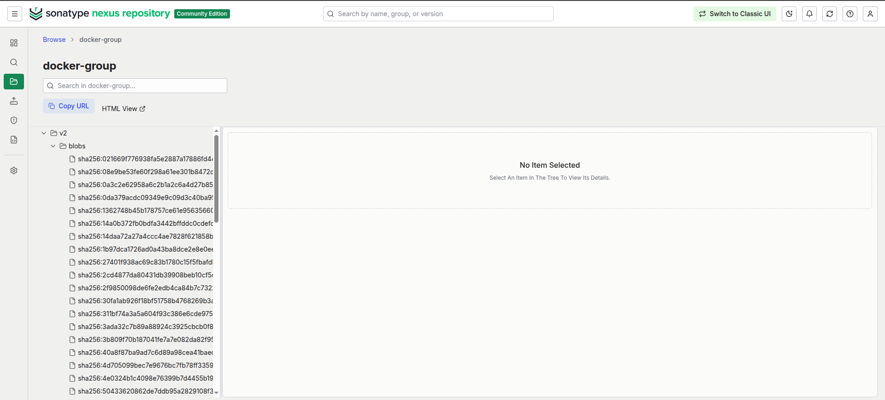

# Cartify: Microservices E-commerce Platform

Cartify is a robust, end-to-end e-commerce marketplace built using a microservices architecture. It leverages **Spring Boot** for the backend, **Angular** for the frontend, and **MongoDB** for persistent storage, with **Kafka** for asynchronous communication — all backed by an automated **Jenkins CI/CD pipeline**.

## 🏗️ Architecture Overview

The system is decomposed into several specialized services, each handling a specific domain of the application:

- **Nginx (Reverse Proxy):** Central ingress handling SSL/HTTPS termination, static asset serving for the Angular frontend, and proxying API traffic (`/api/*`) to the API Gateway.
- **API Gateway:** Entry point for microservice routing and CORS management.
- **Discovery Service (Eureka):** Service registry for dynamic service discovery.
- **User Service:** Manages authentication, user profiles, and roles (CLIENT, SELLER).
- **Product Service:** Handles product catalog management and CRUD operations.
- **Media Service:** Manages image uploads and storage (integrated with Cloudinary).
- **Order Service:** Manages shopping carts, order creation, order tracking, and status management.
- **Frontend:** A modern Angular SPA for user interaction.

### System Diagram (Simplified)
```text
                        [ Client (Browser) ]
                                 |
                                 v (https://localhost:4200)
                    [ Nginx Reverse Proxy / SSL ]
                     /                         \
          (Static Assets)                     (API Requests: /api/*)
                   /                             \
                  v                               v
         [ Angular SPA Frontend ]       [ API Gateway (8080) ]
                                                  |
                 ---------------------------------------------------
                 |                |                |               |
          [User Service]   [Product Service] [Media Service] [Order Service]
             |       |        |       |        |       |        |       |
             v       |        v       |        v       |        v       |
        [User DB]    |   [Product DB] |   [Media DB]   |   [Order DB]   |
                     \________|_______|________|_______/                |
                              |                                         |
                              v                                         v
                      [ Eureka Discovery ]                    [ Kafka Broker (9092) ]
```


## 🚀 Key Features

### 🔐 Security & Auth
- **JWT-based Authentication:** Secure access to protected resources.
- **Role-Based Access Control (RBAC):** Distinct permissions for `CLIENT` and `SELLER`.
- **Password Security:** Hashing and salting with BCrypt.
- **Ownership Enforcement:** Sellers can only manage their own products and media.

### 📦 Product Management
- Sellers can Create, Read, Update, and Delete (CRUD) products.
- Clients can browse the public product catalog.
- Products are linked to media URLs managed by the Media Service.

### 🖼️ Media Handling
- Secure file uploads with MIME type validation (`image/*`).
- Strict file size limits (max 2MB per upload).
- Cloudinary integration for scalable image hosting.

### 🛒 Cart & Order Management
- Shopping cart management (add, update, delete items).
- Order creation and checkout workflow with pricing snapshot.
- Order history tracking and detailed item viewing for buyers.
- Order cancellation and re-order ("redo") functionality.
- Seller-facing order overview to monitor item sales.
- Asynchronous Kafka event publishing on order actions.

### ⚙️ CI/CD & Code Quality
- **Automated Build & Test:** Each Spring Boot service is built and tested independently via Maven Wrapper before deployment.
- **Branch Protection:** Merging into `main` requires both a passing Jenkins status check **and** an approved code review — enforced directly by GitHub branch protection rules.
- **Artifact Management (Nexus):** Every run publishes versioned JARs (`1.0.<build>`) to `maven-releases` and Docker images (version + commit SHA tags) to `docker-hosted`; all dependencies are resolved through Nexus.
- **Rollback Strategy:** Failed deployments automatically redeploy the Nexus images of the last known-good commit (`GIT_PREVIOUS_SUCCESSFUL_COMMIT`); any older version can be redeployed with `IMAGE_TAG=<version> docker compose -p cartify up -d`.
- **Notifications:** Email alerts on build success/failure.

### 🛠️ Technical Stack
- **Backend:** Java 17+, Spring Boot 3, Spring Cloud, Spring Security.
- **Frontend:** Angular 19, Tailwind CSS, Angular Material.
- **Data:** MongoDB (per-service instances).
- **Messaging:** Apache Kafka.
- **Infrastructure:** Docker & Docker Compose (rootless).
- **CI/CD:** Jenkins (Multibranch Pipeline, one Docker agent per stage: `maven`, `node`, `docker:cli`), ngrok (webhook tunnel).

---

## 🛠️ Complete Setup Guide (from zero to a running pipeline)

Run every step in order. Steps marked **(UI)** are done in the Nexus web interface at `http://localhost:8081`.

### Step 0: Prerequisites

- Docker or rootless Podman with Docker Compose. The commands below use `docker`; with Podman, `docker` is an alias for `podman`.
- Java 17 (the Maven Wrapper `./mvnw` is included in each service)
- Node.js, npm and the Angular CLI (`npm install -g @angular/cli`) for the frontend
- `git`, `curl`, `openssl`

### Step 1: Clone the project

```bash
git clone https://github.com/heeemzaaa/nexus.git
cd nexus
```

### Step 2: Create the shared network

Nexus, Jenkins and the pipeline agents talk to each other by name (`nexus`) on this network.

```bash
docker network create ci-net
```

### Step 3: Start Nexus (non-root)

```bash
cp nexus/.env.example nexus/.env
# put a unique key in nexus/.env:
sed -i "s|^NEXUS_SECRET_KEY=.*|NEXUS_SECRET_KEY=$(openssl rand -base64 32)|" nexus/.env

docker compose -f nexus/docker-compose.yml up -d --build
docker ps                                          # wait until nexus is "(healthy)", about 2 minutes

docker exec nexus whoami                           # -> nexus   (Nexus does NOT run as root)
docker exec nexus cat /nexus-data/admin.password   # initial admin password
```

**(UI)** Sign in as `admin` with that password. In the setup wizard:
1. Set a new admin password.
2. Choose **Disable anonymous access**.

### Step 4: Create the repositories (UI)

Go to **Server administration (⚙️) → Repository → Repositories → Create repository**.

| # | Recipe | Name | Settings |
|---|---|---|---|
| 1 | maven2 (hosted) | `maven-releases` | Version policy **Release**, Deployment policy **Disable redeploy** |
| 2 | maven2 (hosted) | `maven-snapshots` | Version policy **Snapshot**, Deployment policy **Allow redeploy** |
| 3 | maven2 (proxy) | `maven-central` | Remote storage `https://repo1.maven.org/maven2/` |
| 4 | maven2 (group) | `maven-public` | Members, in order: `maven-releases`, `maven-snapshots`, `maven-central` |
| 5 | docker (hosted) | `docker-hosted` | HTTP connector **8082**, Deployment policy **Allow redeploy** |
| 6 | docker (proxy) | `docker-proxy` | Remote storage `https://registry-1.docker.io`, Docker index **Use Docker Hub** |
| 7 | docker (group) | `docker-group` | HTTP connector **8083**, members: `docker-hosted`, `docker-proxy` |

A fresh Nexus already contains repositories named `maven-releases`, `maven-snapshots`, `maven-central` and `maven-public`. Check that their settings match the table instead of creating them again.

### Step 5: Enable Docker login (UI)

**Security → Realms:** move **Docker Bearer Token Realm** to *Active*, then **Save**. Without it, `docker login` fails with `unauthorized`.

### Step 6: Create roles and users (UI)

**Security → Roles → Create role → Nexus role:**

| Role ID | Privileges |
|---|---|
| `ci-deployer` | `nx-repository-view-maven2-maven-public-read`, `nx-repository-view-maven2-maven-public-browse`, `nx-repository-view-maven2-maven-releases-add`, `-edit`, `-read`, `nx-repository-view-maven2-maven-snapshots-add`, `-edit`, `-read`, `nx-repository-view-docker-docker-hosted-add`, `-edit`, `-read`, `nx-repository-view-docker-docker-group-read`, `-browse` |
| `developer-readonly` | `nx-repository-view-maven2-maven-public-read`, `-browse`, `nx-repository-view-docker-docker-group-read`, `-browse` |

**Restrict one artifact (content selector):**
1. **Security → Content Selectors → Create:** name `user-service-only`, expression `format == "maven2" and path =^ "/user/user-service/"`
2. **Security → Privileges → Create privilege → Repository Content Selector:** name `user-service-only-read`, content selector `user-service-only`, repository `maven-releases`, actions `read,browse`
3. **Security → Roles → Create role:** `user-team` with the privilege `user-service-only-read`

**Security → Users → Create local user:**

| User | Role | Used by |
|---|---|---|
| `jenkins-ci` | `ci-deployer` | Jenkins (publishing) |
| `dev-readonly` | `developer-readonly` | developers (pull only) |
| `user-team-dev` | `user-team` | can only see `user-service` artifacts |

### Step 7: Allow Docker to use the Nexus registries over HTTP

The Nexus Docker connectors use HTTP, and Docker/Podman use HTTPS by default. This step allows HTTP for `localhost:8082` and `localhost:8083` only:

```bash
./scripts/setup_nexus_registries.sh
```

With Docker Engine instead of Podman, add `"insecure-registries": ["localhost:8082", "localhost:8083"]` to `/etc/docker/daemon.json` and restart Docker.

Check that login works:

```bash
docker login localhost:8082 -u jenkins-ci          # -> Login Succeeded
docker login localhost:8083 -u jenkins-ci          # -> Login Succeeded
```

### Step 8: Configure Maven to use Nexus

```bash
mkdir -p ~/.m2 && cp docs/settings.xml.example ~/.m2/settings.xml

export NEXUS_USERNAME=jenkins-ci
read -rsp 'Nexus password: ' NEXUS_PASSWORD; export NEXUS_PASSWORD; echo
```

[docs/settings.xml.example](docs/settings.xml.example) sends **every** dependency request to `maven-public` and reads the credentials from the two variables above. Keep these variables exported for the next steps.

### Step 9: Build and test (dependencies come from Nexus)

```bash
./scripts/build.sh                                 # package the 6 services
./scripts/test.sh                                  # run their tests

# proof that dependencies are downloaded through Nexus (empty local repository):
cd user-service && ./mvnw -Dmaven.repo.local=/tmp/empty-m2 clean package -DskipTests | grep "Downloading from nexus" | head -3; cd ..
```

**(UI)** **Browse → maven-central** now shows the dependencies that Nexus downloaded and cached.

### Step 10: Publish the JARs to Nexus (several versions)

```bash
./scripts/deploy_to_nexus.sh                       # 0.0.1-SNAPSHOT -> maven-snapshots

REVISION=1.0.1 ./scripts/build.sh
REVISION=1.0.1 ./scripts/deploy_to_nexus.sh        # 1.0.1 -> maven-releases

REVISION=1.0.2 ./scripts/build.sh
REVISION=1.0.2 ./scripts/deploy_to_nexus.sh        # 1.0.2 -> maven-releases
```

To deploy a single service: `cd user-service && ./mvnw deploy -DskipTests -Drevision=1.0.3`

**(UI)** **Browse → maven-releases → user → user-service** lists `1.0.1` and `1.0.2`.

### Step 11: Retrieve a specific JAR version

```bash
cd user-service
./mvnw dependency:get -Dartifact=user:user-service:1.0.1 -Dtransitive=false
cd ..

# or download it directly:
curl -u "$NEXUS_USERNAME:$NEXUS_PASSWORD" -O \
  http://localhost:8081/repository/maven-releases/user/user-service/1.0.1/user-service-1.0.1.jar
```

### Step 12: Build, tag and push the Docker images

```bash
REVISION=1.0.2 ./scripts/build.sh
IMAGE_TAG="$(git rev-parse --short HEAD)" VERSION=1.0.2 ./scripts/publish_docker_to_nexus.sh
# pushes localhost:8082/cartify/<service>:<commit-sha> and :1.0.2 for the 7 images
```

**(UI)** **Browse → docker-hosted → v2 → cartify → user-service → tags** shows both tags.

### Step 13: Pull the images from Nexus

```bash
docker pull localhost:8083/cartify/user-service:1.0.2          # our image, from docker-hosted
docker pull localhost:8083/library/nginx:alpine                # Docker Hub image, through docker-proxy
```

Both pulls use the same address (`docker-group`, port 8083).

### Step 14: Run the application from the Nexus images

```bash
cp .env.example .env
# fill DB_USERNAME, DB_PASSWORD, DB_NAME, CLOUDINARY_URL, SECRET_KEY
# and set IMAGE_TAG=1.0.2 (a tag that exists in Nexus)

# self-signed TLS certificate for the frontend
openssl req -x509 -nodes -days 365 -newkey rsa:2048 \
  -keyout frontend/private.key -out frontend/secureCertificate.crt -subj "/CN=localhost"
touch frontend/securePassphrase

docker compose -p cartify pull
docker compose -p cartify up -d --no-build
docker compose -p cartify ps
```

The application runs at `https://localhost:4200`.

To build the images from source instead of pulling them, run `docker compose -p cartify up -d --build`.

### Step 15: Roll back to a previous version

```bash
IMAGE_TAG=1.0.1 docker compose -p cartify pull
IMAGE_TAG=1.0.1 docker compose -p cartify up -d --no-build
```

Any version stored in Nexus can be redeployed this way, so Nexus always keeps the last known-good build.

### Step 16: Start Jenkins (Configuration as Code)

**1. Jenkins secrets.** Jenkins is configured entirely by [jenkins/casc/jenkins.yaml](jenkins/casc/jenkins.yaml) (Configuration as Code). That file contains no secret: it reads them from `jenkins/.env` and `jenkins/secrets/`, which are both gitignored.

```bash
cp jenkins/.env.example jenkins/.env
# fill in jenkins/.env: Jenkins admin, Nexus jenkins-ci password, GitHub token, SMTP

mkdir -p jenkins/secrets
cp .env                          jenkins/secrets/app.env              # application .env (Step 14)
cp frontend/secureCertificate.crt jenkins/secrets/secureCertificate.crt
cp frontend/private.key          jenkins/secrets/private.key
cp frontend/securePassphrase     jenkins/secrets/securePassphrase
```

**2. Start Jenkins:**

```bash
mkdir -p ~/jenkins_home                                     # Jenkins data, same path on host and in the container
docker compose -f jenkins/docker-compose.yml up -d --build  # http://localhost:8080
```

Log in with `JENKINS_ADMIN_USER` / `JENKINS_ADMIN_PASSWORD` from `jenkins/.env`. There is no setup wizard and nothing to configure in the UI. At startup, Configuration as Code creates:

| What | Value |
|---|---|
| Login | local admin user, sign-up disabled, anonymous access denied |
| Credentials | `nexus-credentials`, `github-token`, `buy01-env-file`, `ssl-cert`, `ssl-key`, `ssl-passphrase` |
| GitHub | commit status with `github-token` |
| E-mail | SMTP server for the success/failure notifications |
| Job | `Nexus`: pipeline from `Jenkinsfile` on `main`, started by a GitHub push |

The configuration is applied again at every start. To change something, edit `jenkins/casc/jenkins.yaml` or `jenkins/.env` and run `docker restart jenkins-controller`. Plugins are listed in [jenkins/plugins.txt](jenkins/plugins.txt) and installed when the image is built.

**3. GitHub webhook:** in the GitHub repository, go to *Settings → Webhooks → Add webhook* and set the payload URL to `<jenkins-url>/github-webhook/` (through ngrok when Jenkins runs locally).

**Agents:** no agent has to be created in Jenkins. Each stage of the [Jenkinsfile](Jenkinsfile) runs in a ready-made Docker image, started on demand by the controller and removed after the stage:

| Stages | Agent image |
|---|---|
| Build, test and publish (backend) | `maven:3.9-eclipse-temurin-17` |
| Build and test (frontend) | `node:22` |
| Publish Docker images, Deliver | `docker:27-cli` |

The controller image ([jenkins/Dockerfile](jenkins/Dockerfile)) adds the `docker` CLI and the plugins. The **Docker Pipeline** plugin provides `agent { docker { ... } }`. All stages share the controller's workspace (`reuseNode true`). This is why Jenkins' home uses the same path on the host and in the container: the agent containers mount the workspace from the host at that path.

### Step 17: Push a change and watch the pipeline publish

```bash
git commit --allow-empty -m "trigger pipeline" && git push
```

The pipeline builds, tests, publishes the JARs as `1.0.<build number>` to `maven-releases`, pushes the images with the same version and the commit SHA to `docker-hosted`, then deploys by pulling them from Nexus. Each new run adds one more version in Nexus.

### After a reboot

Rootless Podman does not restart containers on its own:

```bash
docker start nexus jenkins-controller
# or start them automatically once and for all:
systemctl --user enable --now podman-restart.service
```

---

## 🔁 CI/CD Pipeline

The Jenkins Multibranch Pipeline ([Jenkinsfile](Jenkinsfile)) runs on every push and pull request (GitHub webhook):

```text
push ─▶ Configure Maven for Nexus ─▶ Build ─▶ Test
     ─▶ Publish Maven Artifacts to Nexus ─▶ Publish Docker Images to Nexus ─▶ Deliver (pull from Nexus)
```

| Stage | What it does with Nexus |
|---|---|
| Configure Maven for Nexus | Writes a temporary `settings.xml`: a `mirrorOf=*` mirror to `maven-public` and a `nexus` server entry whose credentials come from the `nexus-credentials` Jenkins credential. |
| Build / Test | Every dependency and plugin is resolved through `maven-public`. All Maven calls receive `-Drevision=1.0.<BUILD_NUMBER>`. |
| Publish Maven Artifacts | `scripts/deploy_to_nexus.sh` runs `mvn deploy` for the 6 services, which uploads JAR and POM to `maven-releases`. |
| Publish Docker Images | `scripts/publish_docker_to_nexus.sh` builds 7 images and pushes each to `docker-hosted` (`localhost:8082`) with two tags: the version (`1.0.<BUILD_NUMBER>`) and the Git commit SHA. |
| Deliver | Logs in to `docker-group` (`localhost:8083`), pulls the images of this commit and restarts the stack with `docker compose up --no-build`. On failure it pulls the images of the last successful commit (rollback). |

Publishing and delivery are skipped for pull requests, so only merged code reaches Nexus.



## 📦 Nexus Artifact Repository

### 1. Installation (non-root)

Nexus runs from the official `sonatype/nexus3` image, extended in [nexus/Dockerfile](nexus/Dockerfile). The container runs as the dedicated **`nexus`** user (`USER nexus` in the Dockerfile and `user: nexus` in [nexus/docker-compose.yml](nexus/docker-compose.yml)), never as root. Its data lives in the `nexus_data` volume.

Setup commands: [Steps 2–3](#step-2-create-the-shared-network).

| Port | Used for |
|---|---|
| `8081` | Web UI, REST API and all Maven repositories |
| `8082` | HTTP connector of `docker-hosted` (push) |
| `8083` | HTTP connector of `docker-group` (pull) |

### 2. Repositories

Created in **Server administration → Repository → Repositories**:

| Name | Format | Type | Configuration |
|---|---|---|---|
| `maven-releases` | maven2 | hosted | Version policy *Release*, deployment policy *Disable redeploy* (a released version is immutable) |
| `maven-snapshots` | maven2 | hosted | Version policy *Snapshot*, *Allow redeploy* |
| `maven-central` | maven2 | proxy | Remote `https://repo1.maven.org/maven2/` |
| `maven-public` | maven2 | group | Members: `maven-releases`, `maven-snapshots`, `maven-central` |
| `docker-hosted` | docker | hosted | HTTP connector `8082`, *Allow redeploy* (a rebuilt commit re-pushes its SHA tag) |
| `docker-proxy` | docker | proxy | Remote `https://registry-1.docker.io`, Docker index *Use Docker Hub* |
| `docker-group` | docker | group | HTTP connector `8083`, members: `docker-hosted`, `docker-proxy` |

The Maven repositories store both JAR and WAR packaging. JARs, WARs and Docker images each have a hosted repository for our own artifacts, a proxy for external ones, and a group that serves both from one URL.

### 3. Maven integration

**Publishing.** Each service POM declares where `mvn deploy` uploads to. The server id `nexus` matches the credentials entry in `settings.xml`:

```xml
<distributionManagement>
    <repository>         <id>nexus</id> <url>${nexus-url}/repository/maven-releases/</url>  </repository>
    <snapshotRepository> <id>nexus</id> <url>${nexus-url}/repository/maven-snapshots/</url> </snapshotRepository>
</distributionManagement>
```

Maven chooses the repository from the version: `1.0.42` goes to `maven-releases`, while `0.0.1-SNAPSHOT` goes to `maven-snapshots`.

**Dependency resolution exclusively through Nexus.** [docs/settings.xml.example](docs/settings.xml.example) mirrors `*` (every repository, Maven Central included) to `maven-public`, so a build never contacts the Internet directly. Nexus fetches missing artifacts once through `maven-central` and caches them. Jenkins generates the same file in its first stage.

Setup commands: [Steps 8–9](#step-8-configure-maven-to-use-nexus).

After the Step 9 build, **Browse → maven-central** shows the cached dependencies (Spring Boot, Jackson, etc.).

### 4. Versioning

Every POM uses Maven [CI-friendly versions](https://maven.apache.org/maven-ci-friendly.html):

```xml
<version>${revision}</version>
<properties>
    <revision>0.0.1-SNAPSHOT</revision>   <!-- local default -->
</properties>
```

- **Local builds** keep `0.0.1-SNAPSHOT` and deploy to `maven-snapshots`.
- **Jenkins** passes `-Drevision=1.0.${BUILD_NUMBER}`, so every pipeline run produces a new, immutable release version in `maven-releases`.
- **`flatten-maven-plugin`** rewrites `${revision}` to the real number in the POM that is deployed, so consumers of `user:user-service:1.0.42` get a valid POM.
- **Docker images** are tagged with the same version **and** the Git commit SHA:

| Tag | Example | Purpose |
|---|---|---|
| version | `cartify/user-service:1.0.42` | Same number as the Maven JAR: JAR ↔ image ↔ Jenkins build #42 |
| commit SHA | `cartify/user-service:3649f09f…` | Trace an image back to the exact source commit (used by Deliver and rollback) |

The image also carries the labels `org.opencontainers.image.version` and `org.opencontainers.image.revision`.

**Traceability:** from a running container's tag you know the Jenkins build (`1.0.42` = build #42). The commit tag gives the exact source revision (`git show <sha>`). Nexus keeps every previous version, so any of them can be fetched again or redeployed.

### 5. Docker integration

Nexus serves Docker over plain HTTP. Podman, like Docker, uses HTTPS by default, so the two Nexus addresses are declared insecure once on the host with [scripts/setup_nexus_registries.sh](scripts/setup_nexus_registries.sh), which installs [jenkins/nexus-registries.conf](jenkins/nexus-registries.conf).

The pipeline uses **`localhost:8082/8083`**, not `nexus:8082`. Jenkins' `docker` CLI only talks to the host's Podman socket, and the host performs the push and pull. The host cannot resolve the `nexus` container name.

**Docker Bearer Token Realm** is enabled in **Security → Realms**. Without it, `docker login` returns `unauthorized`.

### 6. Example commands

Every command is in the setup guide above:

| Operation | Step |
|---|---|
| `mvn deploy` (snapshot and release versions) | [Step 10](#step-10-publish-the-jars-to-nexus-several-versions) |
| `mvn dependency:get` / download an old JAR | [Step 11](#step-11-retrieve-a-specific-jar-version) |
| `docker login` | [Step 7](#step-7-allow-docker-to-use-the-nexus-registries-over-http) |
| `docker build` / tag / `docker push` | [Step 12](#step-12-build-tag-and-push-the-docker-images) |
| `docker pull` | [Step 13](#step-13-pull-the-images-from-nexus) |
| Rollback | [Step 15](#step-15-roll-back-to-a-previous-version) |

### 7. Security and access control

- **Authentication:** the initial `admin` password was changed at first login. **Anonymous access is disabled** (*Security → Anonymous Access*), so every UI, REST, Maven and Docker request must authenticate. An unauthenticated request returns `401`.
- **Realms:** *Local Authenticating Realm*, *Local Authorizing Realm* and *Docker Bearer Token Realm*.
- **Role-based access control:** CI and people get only the privileges they need. Nobody uses `admin` day to day.

| Role | Privileges | Assigned to |
|---|---|---|
| `ci-deployer` | `nx-repository-view-maven2-maven-public-read/browse`, `…-maven-releases-add/edit/read`, `…-maven-snapshots-add/edit/read`, `nx-repository-view-docker-docker-hosted-add/edit/read`, `nx-repository-view-docker-docker-group-read/browse` | `jenkins-ci` (Jenkins credential `nexus-credentials`) |
| `developer-readonly` | `nx-repository-view-maven2-maven-public-read/browse`, `nx-repository-view-docker-docker-group-read/browse` | `dev-readonly` |
| `user-team` | Content-selector privilege `user-service-only` (read, browse) | `user-team-dev` |

- **Repository-level permissions:** `dev-readonly` can pull from the groups, but `mvn deploy` and `docker push` return **403 Forbidden**. Only `ci-deployer` can write, and only to the hosted repositories.
- **Artifact-level restriction:** the content selector `user-service-only` (expression `format == "maven2" and path =^ "/user/user-service/"`) gives `user-team-dev` access to the `user-service` artifacts in `maven-releases` and nothing else.

### 8. Screenshots

The end-to-end flow diagram is in the [CI/CD Pipeline](#-cicd-pipeline) section.

**Nexus runs as the non-root `nexus` user:**



**Maven and Docker repositories** (hosted, proxy and group for each format):



**Image layers served by `docker-group`** after the pipeline pushed and pulled the images:



### Java version note

The subject asks for Java 11. The services target **Java 17** because Spring Boot 3.x and Spring Cloud 2025 require Java 17 as a minimum. Moving to Java 11 would mean downgrading the whole stack to Spring Boot 2.7, which is end-of-life. The Nexus, Maven and Docker workflow described above does not depend on the Java version.

---


## 📖 API Documentation

The **API Gateway** (Port 8080) routes traffic to the following endpoints:

| Service | Endpoint | Description | Auth Required |
|---------|----------|-------------|---------------|
| **User** | `POST /auth/register` | User registration | No |
| **User** | `POST /auth/login` | User login -> JWT | No |
| **User** | `GET /users/me` | Current user profile | Yes |
| **Product** | `GET /api/products` | List all products | No |
| **Product** | `POST /api/products` | Create product | Yes (SELLER) |
| **Media** | `POST /media` | Upload image | Yes (SELLER) |
| **Order** | `POST /carts` | Add item to cart | Yes |
| **Order** | `GET /carts` | Get user cart items | Yes |
| **Order** | `PUT /carts/{id}` | Update cart item quantity | Yes |
| **Order** | `DELETE /carts/{id}` | Remove item from cart | Yes |
| **Order** | `POST /orders` | Create order / Checkout | Yes |
| **Order** | `GET /orders` | List user orders | Yes |
| **Order** | `GET /orders/{id}` | Get order details | Yes |
| **Order** | `GET /orders/{id}/items` | Get order items | Yes |
| **Order** | `PUT /orders/{id}/cancel` | Cancel order | Yes |
| **Order** | `POST /orders/{id}/redo` | Reorder / Redo order | Yes |
| **Order** | `GET /orders/seller` | Get seller orders | Yes (SELLER) |

---

## 🛠️ Developer Scripts

- `build.sh`: Packages all Spring Boot services using Maven Wrapper.
- `test.sh`: Runs the tests of every Spring Boot service.
- `deploy_to_nexus.sh`: `mvn deploy` of every service to Nexus (`REVISION=1.0.x` for a release).
- `publish_docker_to_nexus.sh`: Builds the images and pushes them to `docker-hosted` (commit SHA + `VERSION` tags).
- `setup_nexus_registries.sh`: Allows Podman to reach the Nexus Docker connectors over HTTP.
- `run_docker_dns.sh`: Helper to restart Docker with custom DNS settings (if needed for registry access).

---

## 🧪 Evaluation Criteria Compliance

### MR-Jenk (CI/CD)
- ✅ **Automation:** GitHub-triggered Jenkins Multibranch Pipeline (push + PR events).
- ✅ **Testing Integration:** Backend tests run via Maven; pipeline fails on test failure.
- ✅ **Deployment:** Docker-based deploy with health checks and rollback.
- ✅ **Notifications:** Email alerts on build/deploy status.
- ✅ **Pipeline Quality:** Declarative pipeline, per-service staging, Credentials Store for secrets.

### General
- ✅ **Microservices:** Separated into User, Product, Media, Order, Gateway, and Discovery.
- ✅ **Persistence:** Independent MongoDB instances for each service (User DB, Product DB, Media DB, Order DB).
- ✅ **Media Security:** MIME validation and 2MB limit enforced in Media Service.
- ✅ **Frontend:** Responsive Angular UI with Guards and Interceptors.
- ✅ **Observability:** Actuator `/health` endpoints configured.


